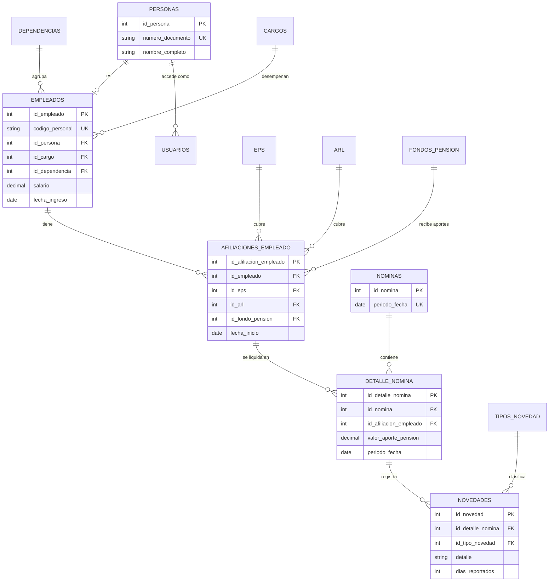
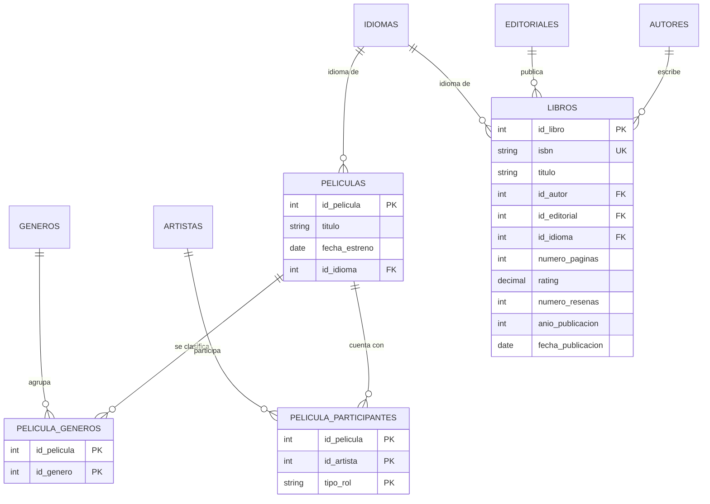
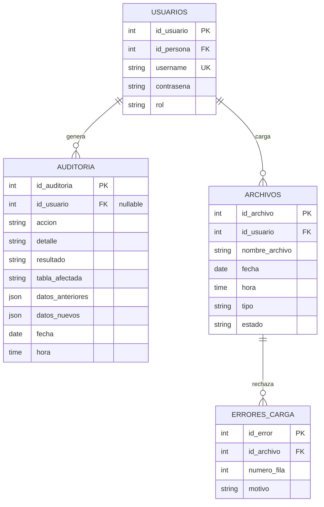
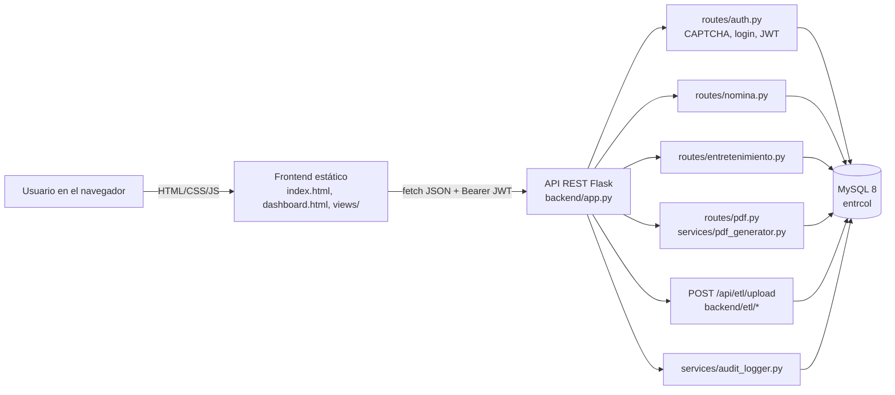

# Informe Formal de Ingeniería — EntreCOL+ / ColPlus-Solutions

**Asignatura:** Teoría de Bases de Datos
**Proyecto:** Sistema de información empresarial EntreCOL+ / ColPlus-Solutions
**Repositorio:** <https://github.com/SixExpert277/TEORIA-DE-BASE-DE-DATOS->
**Versión del documento:** 1.0 — noviembre de 2026

---

## Tabla de contenido

1. [Introducción y alcance](#1-introducción-y-alcance)
2. [Fuentes de datos](#2-fuentes-de-datos)
3. [Modelo Entidad-Relación (MER)](#3-modelo-entidad-relación-mer)
4. [Modelo relacional](#4-modelo-relacional)
5. [Paso del MER a tablas](#5-paso-del-mer-a-tablas)
6. [Normalización: 1FN, 2FN y 3FN](#6-normalización-1fn-2fn-y-3fn)
7. [Seguridad, auditoría y trazabilidad](#7-seguridad-auditoría-y-trazabilidad)
8. [Stack tecnológico y justificación](#8-stack-tecnológico-y-justificación)
9. [Arquitectura de la solución](#9-arquitectura-de-la-solución)
10. [Documentación de scripts y consultas SQL](#10-documentación-de-scripts-y-consultas-sql)
11. [API REST](#11-api-rest)
12. [Estado de integración y pendientes](#12-estado-de-integración-y-pendientes)
13. [Conclusiones](#13-conclusiones)

---

## 1. Introducción y alcance

EntreCOL+ (también ColPlus-Solutions) centraliza tres dominios de información que en la organización vivían en archivos aislados:

| Dominio | Fuente original | Uso en el sistema |
|---|---|---|
| Personal y nómina | `data_sources/Nomina.xlsx` | Empleados, dependencias, cargos, afiliaciones a EPS/ARL/pensión, nómina mensual y novedades (incapacidades, vacaciones, bonificaciones, auxilio de transporte). |
| Películas | `data_sources/movies.dat` | Catálogo de películas y sus géneros. |
| Libros | `data_sources/Books.json` | Catálogo de libros con autor, editorial, idioma, rating y año de publicación. |

El sistema ofrece:

- Autenticación con contraseña cifrada (bcrypt) y un segundo factor CAPTCHA antes de emitir un token JWT.
- Cinco reportes analíticos (Nómina, Información Personal, Salud y Pensión, Novedades y Base-Entretenimiento) con filtros dinámicos, ordenamiento `ASC`/`DESC`, gráficos estadísticos y exportación a PDF.
- Operaciones CRUD sobre empleados, novedades manuales, películas y libros.
- Carga incremental de nuevos archivos `.xlsx`, `.dat` y `.json` sin duplicar registros.
- Auditoría de accesos, exportaciones, cargas y cambios de datos, e historial de archivos cargados con sus filas rechazadas.

## 2. Fuentes de datos

### 2.1 `Nomina.xlsx`

Libro de Excel con una hoja maestra y una hoja mensual.

**Hoja maestra (una fila por empleado):**

| Columna | Tipo observado | Observación |
|---|---|---|
| `CÓDIGO` | numérico | Identificador natural del empleado → `codigo_personal`. |
| `NOMBRE DEL EMPLEADO` | texto | Nombre completo en una sola celda. |
| `DEPENDENCIA` | texto | Se repite en muchas filas (catálogo). |
| `CARGO` | texto | Se repite en muchas filas (catálogo). |
| `FECHA INGRESO` | entero `YYYYMMDD` | Se convierte a `DATE`. |
| `EPS`, `ARL`, `PENSIÓN` | texto | Entidades de seguridad social (catálogos). |
| `SUELDO` | numérico | Salario base. |

**Hoja mensual (una fila por empleado y mes):** `CÓDIGO`, `BONIFICACIÓN`, `TRANSPORTE`, `NOVEDAD INCAPACIDAD` (marca `X`), `FECHA INICIO INCAPACIDAD`, `FECHA TERMINACIÓN INCAPACIDAD`, `NUMERO DIAS INCAPACIDADES EN EL MES`, `NOVEDAD VACACIONES` (marca `X`), `FECHA DE INICIO DE VACACIONES`, `FECHA TERMINACION DE VACACIONES`, `NUMERO DE DIAS VACACIONES`.

Problemas de diseño de la fuente que la normalización resuelve: grupos repetitivos de novedades en columnas (incapacidad y vacaciones con sus fechas y días), catálogos escritos como texto libre en cada fila, la hoja no trae documento de identidad ni período explícito.

### 2.2 `movies.dat`

Archivo de texto con una película por línea y campos separados por `::`:

```text
1::Toy Story (1995)::Adventure|Animation|Children|Comedy|Fantasy
```

El año viene dentro del título y los géneros llegan como una lista separada por `|` (atributo multivaluado). El archivo real tiene **10.681** registros.

### 2.3 `Books.json`

Arreglo JSON de objetos con `title`, `authors` (varios autores separados por `/`), `average_rating`, `isbn`, `isbn13`, `language_code`, `num_pages`, `text_reviews_count`, `publication_date` (`MM/DD/AAAA`) y `publisher`. Los valores numéricos llegan como texto. El archivo real tiene **11.127** registros, de los cuales 4 tienen columnas corridas (filas 3349, 4703, 5878 y 8980) y se envían a `errores_carga`.

## 3. Modelo Entidad-Relación (MER)

Los atributos se nombran sin tildes, espacios ni paréntesis. Las cardinalidades se expresan en notación de pata de gallo.

### 3.1 Módulo de personal y nómina



### 3.2 Módulo de entretenimiento



### 3.3 Módulo de seguridad y trazabilidad



### 3.4 Cardinalidades y reglas de negocio

| Relación | Cardinalidad | Regla |
|---|---|---|
| `personas` — `empleados` | 1 : 0..1 | Una persona puede ser o no empleado; un empleado es exactamente una persona. |
| `dependencias` / `cargos` — `empleados` | 1 : N | Cada empleado pertenece a una dependencia y ocupa un cargo. |
| `empleados` — `afiliaciones_empleado` | 1 : N | Historial de afiliaciones; la vigente es la de `fecha_inicio` más reciente. |
| `nominas` — `detalle_nomina` | 1 : N | Una nómina por período (`periodo_fecha` único) con un detalle por afiliación. |
| `detalle_nomina` — `novedades` | 1 : N | Un detalle puede tener varias novedades, a lo sumo una por tipo. |
| `peliculas` — `generos` | N : M | Resuelta con `pelicula_generos`. |
| `peliculas` — `artistas` | N : M | Resuelta con `pelicula_participantes` y el rol (`DIRECTOR`, `ACTOR`). |
| `autores` / `editoriales` / `idiomas` — `libros` | 1 : N | Catálogos independientes. |
| `usuarios` — `auditoria` | 0..1 : N | `id_usuario` admite NULL para registrar intentos de acceso de usuarios inexistentes. |
| `archivos` — `errores_carga` | 1 : N | Cada fila rechazada queda asociada al lote cargado. |

## 4. Modelo relacional

Notación: **PK** subrayada como `PK`, claves foráneas como `FK → tabla`, llaves únicas como `UK`.

| Tabla | Atributos | Llaves |
|---|---|---|
| `cargos` | `id_cargo`, `nombre` | PK `id_cargo`; UK `nombre` |
| `dependencias` | `id_dependencia`, `nombre` | PK `id_dependencia`; UK `nombre` |
| `eps` | `id_eps`, `nombre` | PK `id_eps`; UK `nombre` |
| `arl` | `id_arl`, `nombre` | PK `id_arl`; UK `nombre` |
| `fondos_pension` | `id_fondo_pension`, `nombre` | PK `id_fondo_pension`; UK `nombre` |
| `tipos_novedad` | `id_tipo_novedad`, `nombre` | PK; UK `nombre` (`INCAPACIDAD`, `VACACIONES`, `BONIFICACION`, `TRANSPORTE`) |
| `personas` | `id_persona`, `numero_documento`, `nombre_completo` | PK; UK `numero_documento` |
| `empleados` | `id_empleado`, `codigo_personal`, `id_persona`, `id_cargo`, `id_dependencia`, `salario`, `fecha_ingreso` | PK; UK `codigo_personal`; FK → `personas`, `cargos`, `dependencias` |
| `afiliaciones_empleado` | `id_afiliacion_empleado`, `id_empleado`, `id_eps`, `id_arl`, `id_fondo_pension`, `fecha_inicio` | PK; UK (`id_empleado`, `fecha_inicio`); FK → `empleados`, `eps`, `arl`, `fondos_pension` |
| `nominas` | `id_nomina`, `periodo_fecha` | PK; UK `periodo_fecha` |
| `detalle_nomina` | `id_detalle_nomina`, `id_nomina`, `id_afiliacion_empleado`, `valor_aporte_pension`, `periodo_fecha` | PK; UK (`id_nomina`, `id_afiliacion_empleado`); FK → `nominas`, `afiliaciones_empleado` |
| `novedades` | `id_novedad`, `id_detalle_nomina`, `id_tipo_novedad`, `detalle`, `dias_reportados` | PK; UK (`id_detalle_nomina`, `id_tipo_novedad`); FK → `detalle_nomina`, `tipos_novedad` |
| `generos` | `id_genero`, `nombre` | PK; UK `nombre` |
| `idiomas` | `id_idioma`, `nombre` | PK; UK `nombre` |
| `artistas` | `id_artista`, `nombre` | PK; UK `nombre` |
| `peliculas` | `id_pelicula`, `titulo`, `fecha_estreno`, `id_idioma`, `rating` | PK `id_pelicula` (id del archivo fuente); FK → `idiomas` |
| `pelicula_generos` | `id_pelicula`, `id_genero` | PK compuesta; FK → `peliculas`, `generos` |
| `pelicula_participantes` | `id_pelicula`, `id_artista`, `tipo_rol` | PK compuesta; FK → `peliculas`, `artistas` |
| `autores` | `id_autor`, `nombre` | PK; UK `nombre` |
| `editoriales` | `id_editorial`, `nombre` | PK; UK `nombre` |
| `libros` | `id_libro`, `titulo`, `isbn`, `isbn13`, `id_autor`, `id_editorial`, `id_idioma`, `numero_paginas`, `rating`, `numero_resenas`, `anio_publicacion`, `fecha_publicacion` | PK; UK `isbn`; FK → `autores`, `editoriales`, `idiomas` |
| `usuarios` | `id_usuario`, `id_persona`, `username`, `contrasena`, `rol` | PK; UK `username`; FK → `personas` (NULL permitido) |
| `auditoria` | `id_auditoria`, `id_usuario`, `accion`, `detalle`, `resultado`, `tabla_afectada`, `datos_anteriores`, `datos_nuevos`, `fecha`, `hora` | PK; FK → `usuarios` (NULL permitido) |
| `archivos` | `id_archivo`, `id_usuario`, `nombre_archivo`, `fecha`, `hora`, `tipo`, `estado` | PK; FK → `usuarios` |
| `errores_carga` | `id_error`, `id_archivo`, `numero_fila`, `motivo` | PK; FK → `archivos` |

Índices de rendimiento sobre columnas de filtro y ordenamiento frecuente: `libros.rating`, `libros.anio_publicacion`, `peliculas.fecha_estreno`, `empleados.fecha_ingreso` y `empleados.codigo_personal` (este último ya cubierto por su llave única).

## 5. Paso del MER a tablas

Reglas aplicadas en la transformación:

1. **Entidad fuerte → tabla.** Cada entidad (`personas`, `empleados`, `peliculas`, `libros`, `usuarios`, etc.) se convierte en una tabla con clave primaria sustituta entera autoincremental, salvo `peliculas`, que conserva el identificador del archivo fuente para que las cargas incrementales actualicen la misma fila.
2. **Identificadores naturales → `UNIQUE`.** `numero_documento`, `codigo_personal`, `isbn` y `username` identifican al objeto en el mundo real, por eso llevan llave única. Esto es lo que permite el `UPSERT` (`INSERT ... ON DUPLICATE KEY UPDATE`) de la carga incremental sin duplicados.
3. **Relación 1:N → clave foránea en el lado N.** Por ejemplo `empleados.id_dependencia` y `libros.id_autor`.
4. **Relación 1:0..1 (`personas`—`empleados`) → FK en la entidad dependiente** (`empleados.id_persona`), porque no toda persona es empleado (puede ser solo usuario).
5. **Relación N:M → tabla intermedia** con PK compuesta por las dos FK: `pelicula_generos`; y con un atributo propio de la relación incluido en la PK: `pelicula_participantes.tipo_rol`.
6. **Atributo multivaluado → tabla propia.** Los géneros `Adventure|Animation|...` dejan de ser una cadena y pasan a filas de `pelicula_generos`. Las novedades en columnas pasan a filas de `novedades`.
7. **Atributo derivado → no se almacena salvo necesidad histórica.** El año de estreno se obtiene de `fecha_estreno`; `anio_publicacion` se guarda en `libros` solo porque los reportes Top 5 por año lo usan como partición y lleva índice. `valor_aporte_pension` sí se guarda en `detalle_nomina` porque es un valor histórico de cada período (si cambia el salario, el aporte liquidado del mes anterior no debe cambiar).
8. **Catálogos → tablas independientes** para que cada nombre exista una sola vez (`cargos`, `dependencias`, `eps`, `arl`, `fondos_pension`, `tipos_novedad`, `generos`, `idiomas`, `artistas`, `autores`, `editoriales`).

## 6. Normalización: 1FN, 2FN y 3FN

> La normalización del modelo corresponde al Issue #1 del repositorio. Esta sección consolida la justificación paso a paso sobre las estructuras que efectivamente usan los procesos ETL y el backend. Debe cotejarse con los diagramas editables que se suban a `docs/modelos_bd/`.

### 6.1 Forma no normalizada (FNN) de la nómina

Si se llevara la planilla de Excel tal cual a una sola tabla, cada fila mezclaría al empleado, sus catálogos y las novedades del mes:

| CODIGO | NOMBRE | DEPENDENCIA | CARGO | EPS | PENSION | SUELDO | INCAP | INI_INCAP | FIN_INCAP | DIAS_INCAP | VAC | INI_VAC | FIN_VAC | DIAS_VAC | BONIF | TRANSP |
|---|---|---|---|---|---|---|---|---|---|---|---|---|---|---|---|---|
| 1001 | empleado_01 | Contabilidad | Analista | EPS_A | Fondo_X | 3.500.000 | X | 2022-03-02 | 2022-03-04 | 3 | | | | | 150.000 | 140.606 |

Problemas: grupos repetitivos (incapacidad y vacaciones son el mismo concepto "novedad" repetido en columnas), anomalías de inserción (no se puede registrar una dependencia sin empleados), de actualización (renombrar una EPS obliga a editar todas las filas) y de borrado (al eliminar el único empleado de un cargo se pierde el cargo).

### 6.2 Primera Forma Normal (1FN)

Condición: todos los atributos son atómicos, no hay grupos repetitivos y cada fila se identifica por una clave.

Acciones aplicadas:

- Los grupos `INCAP/INI_INCAP/FIN_INCAP/DIAS_INCAP`, `VAC/...`, `BONIF` y `TRANSP` se convierten en filas de una relación de novedades con atributo `tipo_novedad`: `NOVEDAD(codigo, periodo, tipo_novedad, detalle, dias_reportados)`.
- Los géneros `Adventure|Animation|Comedy` de cada película se separan en filas: `PELICULA_GENERO(id_pelicula, genero)`.
- El título `Toy Story (1995)` se descompone en `titulo = "Toy Story"` y `fecha_estreno = 1995-01-01`.
- Los autores `Autor A/Autor B` de un libro se separan; el modelo actual conserva el autor principal en `libros.id_autor` (si se requieren todos los coautores, se agrega la tabla puente `libro_autores(id_libro, id_autor)` sin afectar las demás formas normales).
- Las fechas `YYYYMMDD` y `MM/DD/AAAA` pasan a `DATE`; los números en texto pasan a tipos numéricos.

Resultado en 1FN (nómina):

- `EMPLEADO_MES(codigo, periodo, nombre, dependencia, cargo, eps, arl, pension, sueldo, aporte_pension)` con clave (`codigo`, `periodo`).
- `NOVEDAD(codigo, periodo, tipo_novedad, detalle, dias_reportados)` con clave (`codigo`, `periodo`, `tipo_novedad`).

### 6.3 Segunda Forma Normal (2FN)

Condición: estar en 1FN y que ningún atributo no clave dependa solo de una parte de una clave compuesta.

En `EMPLEADO_MES(codigo, periodo, ...)` se verifican las dependencias funcionales:

- `codigo → nombre, dependencia, cargo, sueldo, fecha_ingreso` (dependen solo del empleado, no del período): **dependencia parcial**.
- `codigo → eps, arl, pension` (afiliación vigente del empleado): **dependencia parcial**.
- `(codigo, periodo) → aporte_pension`: dependencia completa.

Descomposición:

- `EMPLEADO(codigo, nombre, dependencia, cargo, sueldo, fecha_ingreso)`.
- `AFILIACION(codigo, fecha_inicio, eps, arl, pension)`.
- `NOMINA(periodo)`.
- `DETALLE_NOMINA(codigo, periodo, aporte_pension)`.
- `NOVEDAD(codigo, periodo, tipo_novedad, detalle, dias_reportados)`: sus atributos dependen de la clave completa, ya cumple 2FN.

En entretenimiento, `PELICULA_GENERO(id_pelicula, genero)` no tiene atributos no clave y `PELICULA(id_pelicula, titulo, fecha_estreno)` tiene clave simple, por lo que ambas cumplen 2FN. Para participantes, `tipo_rol` forma parte de la clave porque un mismo artista puede ser director y actor de la misma película.

### 6.4 Tercera Forma Normal (3FN)

Condición: estar en 2FN y que ningún atributo no clave dependa transitivamente de la clave a través de otro atributo no clave.

Dependencias transitivas detectadas y su solución:

| Relación | Dependencia transitiva | Solución |
|---|---|---|
| `EMPLEADO` | `codigo → dependencia → (nombre de la dependencia)` | Catálogo `dependencias(id_dependencia, nombre)` y FK `empleados.id_dependencia`. |
| `EMPLEADO` | `codigo → cargo → (nombre del cargo)` | Catálogo `cargos` y FK `empleados.id_cargo`. |
| `EMPLEADO` | `codigo → documento → nombre_completo` (el nombre es de la persona, no del rol de empleado) | Tabla `personas(id_persona, numero_documento, nombre_completo)` y FK `empleados.id_persona`. |
| `AFILIACION` | `eps`, `arl`, `pension` como texto | Catálogos `eps`, `arl`, `fondos_pension`. |
| `NOVEDAD` | `tipo_novedad` como texto | Catálogo `tipos_novedad`. |
| `LIBRO` | `isbn → autor → (nombre)`, `isbn → editorial`, `isbn → idioma` | Catálogos `autores`, `editoriales`, `idiomas`. |
| `PELICULA_GENERO` | `genero` como texto | Catálogo `generos`. |

Además, la jerarquía transaccional queda sin ciclos: `personas → empleados → afiliaciones_empleado → detalle_nomina ← nominas`, y `detalle_nomina → novedades`. El período de la novedad no se guarda en `novedades` porque ya lo determina su `detalle_nomina` (guardarlo sería una dependencia transitiva). `detalle_nomina.periodo_fecha` replica el período de `nominas` únicamente para permitir el índice de filtro por rango F1–F2; es una redundancia controlada que el ETL mantiene coherente y se documenta como decisión de rendimiento.

### 6.5 Verificación final

Cada tabla del modelo relacional de la sección 4 cumple:

- **1FN:** dominios atómicos, sin listas ni grupos repetitivos, con clave primaria.
- **2FN:** las tablas con clave compuesta (`pelicula_generos`, `pelicula_participantes`) no tienen atributos no clave que dependan de una parte de la clave; las demás tienen clave simple.
- **3FN:** todo atributo no clave depende únicamente de la clave primaria; los nombres repetidos viven en catálogos referenciados por FK.

## 7. Seguridad, auditoría y trazabilidad

| Mecanismo | Implementación |
|---|---|
| Contraseñas | Hash bcrypt con sal aleatoria (`usuarios.contrasena`, nunca texto plano). |
| Segundo factor | `GET /api/auth/captcha` genera una imagen PNG con 5 caracteres, válida 240 s y de un solo uso. El login exige `captcha_id` y `captcha_respuesta` antes de verificar la contraseña. |
| Sesión | Token JWT (HS256) con expiración de 8 horas, enviado en `Authorization: Bearer <token>`. Las rutas privadas usan el decorador `token_required`. |
| Auditoría de aplicación | `services/audit_logger.py` registra en `auditoria` los logins exitosos y fallidos (incluso de usuarios inexistentes con `id_usuario` NULL), las exportaciones a PDF y las cargas de archivos. |
| Auditoría de datos | Triggers `AFTER INSERT/UPDATE/DELETE` sobre `empleados`, `novedades`, `peliculas` y `libros` (script `sql/02_triggers_auditoria.sql`) que guardan `datos_anteriores` y `datos_nuevos` en JSON. |
| Trazabilidad de cargas | Cada carga crea un registro en `archivos` (usuario, fecha, hora, tipo, estado) y cada fila rechazada queda en `errores_carga` con número de fila y motivo. |
| Inyección SQL | Todas las consultas usan parámetros `%s`; los valores de ordenamiento se validan contra una lista blanca (`ASC`/`DESC`). |
| Frontend | El token se guarda en `sessionStorage` (se borra al cerrar la pestaña), se valida la expiración antes de entrar al panel y cualquier 401 devuelve al login. El PDF se descarga con `fetch` y `Bearer` y se muestra como `blob:` en el `iframe`, sin exponer el token en la URL. |

## 8. Stack tecnológico y justificación

| Capa | Tecnología | Justificación |
|---|---|---|
| Base de datos | MySQL 8.0 (`utf8mb4_unicode_ci`) | Motor relacional exigido por la asignatura; soporta funciones de ventana (`ROW_NUMBER() OVER (PARTITION BY ...)`) necesarias para el Top 5 por año, tipo `JSON` para la auditoría, triggers y procedimientos almacenados. |
| Lenguaje backend | Python 3 | Lenguaje con el mejor ecosistema para ETL (pandas, openpyxl, json nativo), sintaxis legible para un equipo académico y librerías maduras para cifrado, JWT y PDF. |
| Framework web | Flask 3 + flask-cors | Microframework sin capas ocultas: cada ruta y consulta SQL queda explícita, lo que facilita relacionar el código con el modelo relacional. Los blueprints separan `auth`, `pdf`, `nomina`, `entretenimiento` y `etl`. |
| Acceso a datos | mysql-connector-python | Conector oficial de Oracle para MySQL, consultas parametrizadas sin ORM, de modo que el SQL del curso es el que se ejecuta. |
| ETL | pandas, openpyxl | Lectura de las varias hojas del Excel y limpieza tabular; `executemany` por lotes con `ON DUPLICATE KEY UPDATE` para la carga incremental. |
| Seguridad | bcrypt, PyJWT, Pillow | Hash con sal, tokens firmados y generación de la imagen CAPTCHA en el propio servidor sin depender de servicios externos. |
| Reportes PDF | ReportLab | Genera el PDF en memoria con encabezado institucional, paginación "Página X de Y" y tablas con ajuste de texto; se devuelve con `Content-Disposition: inline` para la vista previa. |
| Frontend | HTML5, CSS3 y JavaScript sin framework | No requiere compilación ni `npm`: se abre con Live Server. El código se organiza en módulos por responsabilidad (`api.js`, `auth.js`, `charts.js`, `reports.js`, `views/`). |
| Gráficos | Chart.js 4 | Librería ligera basada en `canvas` con gráficos de torta y barras comparativas; se destruye la instancia previa antes de redibujar para evitar fugas de memoria. |
| Colaboración | Git y GitHub | Ramas por funcionalidad, Pull Requests revisados por el líder y prohibición de commits directos a `main`. |

## 9. Arquitectura de la solución



Flujo de autenticación:

1. El navegador pide `GET /api/auth/captcha` y muestra la imagen (`data:image/png;base64,...`).
2. El usuario envía `POST /api/auth/login` con `username`, `password`, `captcha_id` y `captcha_respuesta`.
3. El servidor consume el CAPTCHA (un solo uso), verifica el hash bcrypt, registra el evento en `auditoria` y devuelve el JWT.
4. El frontend decodifica el JWT, valida `exp`, lo guarda en `sessionStorage` y redirige a `dashboard.html`.

## 10. Documentación de scripts y consultas SQL

### 10.1 Scripts del repositorio

| Script | Contenido | Orden de ejecución |
|---|---|---|
| `sql/01_schema.sql` | DDL idempotente (`CREATE TABLE IF NOT EXISTS`) de las 25 tablas de la sección 4 con PK, FK, UK, índices y `utf8mb4_unicode_ci`. | 1 |
| `sql/02_triggers_auditoria.sql` | Triggers `AFTER INSERT`, `AFTER UPDATE` y `AFTER DELETE` sobre `empleados`, `novedades`, `peliculas` y `libros` que insertan en `auditoria` la acción, la tabla, la fecha, la hora y los datos anteriores/nuevos en JSON (`JSON_OBJECT(...)`). | 2 |
| `sql/03_stored_procedures.sql` | Procedimientos para Top N libros (`ASC`/`DESC`), Top 5 mejor/peor por año, empleados con novedades entre F1 y F2 (`MM/AAAA`) con conteo por dependencia y cargo, y películas con exactamente N géneros filtradas por F1–F2. | 3 |

Después de los scripts se ejecutan las cargas iniciales:

```bash
python backend/etl/load_nomina.py --archivo data_sources/Nomina.xlsx --periodo-fecha 2022-03-01
python backend/etl/load_peliculas.py --archivo data_sources/movies.dat
python backend/etl/load_libros.py --archivo data_sources/Books.json
```

### 10.2 Consultas principales de los reportes

**Nómina por dependencia y cargo** (agrupadores ascendentes, nombres en el orden elegido):

```sql
SELECT e.codigo_personal, p.nombre_completo, d.nombre, c.nombre, e.salario
FROM empleados e
JOIN personas p      ON p.id_persona = e.id_persona
JOIN cargos c        ON c.id_cargo = e.id_cargo
JOIN dependencias d  ON d.id_dependencia = e.id_dependencia
ORDER BY d.nombre ASC, c.nombre ASC, p.nombre_completo DESC;
```

**Frecuencia de EPS por dependencia** (`LEFT JOIN` para contar también a quien no tiene afiliación):

```sql
SELECT d.nombre, COALESCE(ep.nombre, 'Sin EPS'), COUNT(*)
FROM empleados e
JOIN dependencias d ON d.id_dependencia = e.id_dependencia
LEFT JOIN afiliaciones_empleado a ON a.id_empleado = e.id_empleado
LEFT JOIN eps ep ON ep.id_eps = a.id_eps
GROUP BY d.nombre, ep.nombre
ORDER BY d.nombre ASC, ep.nombre ASC;
```

**Novedades entre F1 y F2 en formato `MM/AAAA`.** El backend convierte `F1 = 01/2022` en `2022-01-01` y `F2 = 03/2022` en el primer día del mes siguiente (`2022-04-01`) para usar un rango semiabierto que aprovecha el índice:

```sql
SELECT d.nombre, c.nombre, COUNT(*)
FROM empleados e
JOIN personas p ON p.id_persona = e.id_persona
JOIN cargos c ON c.id_cargo = e.id_cargo
JOIN dependencias d ON d.id_dependencia = e.id_dependencia
JOIN afiliaciones_empleado a ON a.id_empleado = e.id_empleado
JOIN detalle_nomina dn ON dn.id_afiliacion_empleado = a.id_afiliacion_empleado
JOIN novedades n ON n.id_detalle_nomina = dn.id_detalle_nomina
WHERE dn.periodo_fecha >= '2022-01-01' AND dn.periodo_fecha < '2022-04-01'
GROUP BY d.nombre, c.nombre
ORDER BY d.nombre ASC, c.nombre ASC;
```

**Películas con exactamente N géneros** (`HAVING` sobre el conteo de la tabla intermedia):

```sql
SELECT pe.titulo, pe.fecha_estreno, COUNT(pg.id_genero) AS cantidad_generos
FROM peliculas pe
JOIN pelicula_generos pg ON pg.id_pelicula = pe.id_pelicula
GROUP BY pe.id_pelicula, pe.titulo, pe.fecha_estreno
HAVING COUNT(pg.id_genero) = 3
ORDER BY pe.titulo ASC;
```

**Top N libros por rating** (subconsulta con `LIMIT` y luego orden por título según el usuario):

```sql
SELECT t.titulo, a.nombre, t.rating, t.numero_resenas, t.anio_publicacion
FROM (SELECT titulo, id_autor, rating, numero_resenas, anio_publicacion
      FROM libros WHERE rating IS NOT NULL
      ORDER BY rating DESC, numero_resenas DESC LIMIT 10) t
JOIN autores a ON a.id_autor = t.id_autor
ORDER BY t.titulo ASC;
```

**Top 5 mejores (o peores) libros por año** con función de ventana; para los peores se cambia `rating DESC` por `rating ASC`:

```sql
SELECT r.anio_publicacion, r.titulo, a.nombre, r.rating
FROM (SELECT l.titulo, l.id_autor, l.rating, l.anio_publicacion,
             ROW_NUMBER() OVER (PARTITION BY l.anio_publicacion
                                ORDER BY l.rating DESC, l.numero_resenas DESC) AS posicion
      FROM libros l
      WHERE l.rating IS NOT NULL AND l.anio_publicacion IS NOT NULL) r
JOIN autores a ON a.id_autor = r.id_autor
WHERE r.posicion <= 5
ORDER BY r.anio_publicacion ASC, r.titulo ASC;
```

**Carga incremental sin duplicados** (ejemplo de `libros`, la clave natural es `isbn`):

```sql
INSERT INTO libros (titulo, isbn, isbn13, id_autor, id_editorial, id_idioma, numero_paginas,
                    rating, numero_resenas, anio_publicacion, fecha_publicacion)
VALUES (%s, %s, %s, %s, %s, %s, %s, %s, %s, %s, %s)
ON DUPLICATE KEY UPDATE titulo = VALUES(titulo), rating = VALUES(rating),
                        numero_resenas = VALUES(numero_resenas);
```

## 11. API REST

Todas las rutas, salvo `captcha`, `login`, `register` y `health`, exigen `Authorization: Bearer <token>`. Los errores responden `{"error": "mensaje"}`.

| Método | Ruta | Descripción |
|---|---|---|
| GET | `/api/auth/captcha` | Desafío CAPTCHA (`captcha_id`, `imagen_base64`, `expira_en_segundos`). |
| POST | `/api/auth/login` | Login con CAPTCHA; devuelve `token`, `token_type`, `expira_en_horas`, `usuario`. |
| POST | `/api/auth/register` | Registro de usuario con rol `admin`, `auditor` o `usuario`. |
| GET | `/api/pdf/reporte/{tipo}` | PDF `inline` de `nomina`, `informacion_personal`, `salud_pension`, `novedades` o `entretenimiento` (con `subtipo`). |
| GET/POST | `/api/nomina/empleados` | Listar (`orden`, `modalidad`, `q`, `dependencia_id`, `cargo_id`) y crear empleados. |
| GET/PUT/DELETE | `/api/nomina/empleados/{id}` | Consultar, editar y eliminar un empleado. |
| GET/POST | `/api/nomina/novedades` | Listar y registrar novedades manuales. |
| GET/PUT/DELETE | `/api/nomina/novedades/{id}` | Consultar, editar y eliminar una novedad. |
| GET | `/api/nomina/catalogos` | Dependencias, cargos, EPS, fondos de pensión y tipos de novedad para los formularios. |
| GET | `/api/nomina/reporte/dependencias` | Empleados por dependencia (gráfico de torta). |
| GET | `/api/nomina/reporte/dependencias-cargos` | Empleados por dependencia y cargo (barras comparativas). |
| GET | `/api/nomina/reporte/empleado/{id}` | Información personal con discriminación de novedades. |
| GET | `/api/nomina/reporte/salud-pension` | Frecuencias de EPS y pensión, generales y por dependencia. |
| GET | `/api/nomina/reporte/cargo-eps`, `/cargo-pension` | Listados por cargo y entidad con `orden`. |
| GET | `/api/nomina/reporte/novedades` | Novedades entre `f1` y `f2` (`MM/AAAA`) y conteo por dependencia y cargo. |
| GET/POST | `/api/entretenimiento/peliculas` | Búsqueda paginada (`q`, `genero`, `anio`, `orden`, `pagina`, `limite`) y creación. |
| GET/PUT/DELETE | `/api/entretenimiento/peliculas/{id}` | Consultar, editar y eliminar una película. |
| GET/POST | `/api/entretenimiento/libros` | Búsqueda paginada (`q`, `autor`, `anio`, `rating_min`, `orden`) y creación. |
| GET/PUT/DELETE | `/api/entretenimiento/libros/{id}` | Consultar, editar y eliminar un libro. |
| GET | `/api/entretenimiento/reporte/peliculas-genero` | Películas por género entre `f1` y `f2` (`YYYY-MM-DD`). |
| GET | `/api/entretenimiento/reporte/peliculas-n-generos` | Películas con exactamente `n` géneros y conteo total. |
| GET | `/api/entretenimiento/reporte/top-libros` | Top `n` libros por rating. |
| GET | `/api/entretenimiento/reporte/top5-libros-anio` | Top 5 mejor y peor rating por año (`mejores`, `peores`). |
| GET | `/api/entretenimiento/grafico/peliculas-genero` | Frecuencia de películas por género entre `f1` y `f2`. |
| GET | `/api/entretenimiento/grafico/libros-anio` | Frecuencia de libros por año de publicación entre `f1` y `f2`. |
| POST | `/api/etl/upload` | Carga `multipart/form-data` (campo `archivo`, y `periodo_fecha` para `.xlsx`); devuelve `registros_procesados`, `registros_insertados`, `errores`, `id_archivo`, `estado`. |
| GET | `/api/etl/archivos` | Historial de archivos con `total_errores`. |
| GET | `/api/etl/archivos/{id}/errores` | Filas rechazadas (`errores_carga`) de un archivo. |
| GET | `/api/auditoria` | Registros de auditoría filtrables por `accion`, `resultado`, `tabla_afectada`, `desde`, `hasta`, `limite`. |

## 12. Estado de integración y pendientes

Estado del repositorio al cierre de este documento (rama `feat/frontend-dashboard-y-docs`):

| Componente | Issue | Estado |
|---|---|---|
| Modelo y normalización (diagramas editables en `docs/modelos_bd/`) | #1 | Pendiente de subir los archivos editables y exportaciones. |
| `sql/01_schema.sql` | #2 | Vacío en `main`; las columnas de la sección 4 son las que asumen los ETL (PR #13). |
| `sql/02_triggers_auditoria.sql`, `sql/03_stored_procedures.sql` | #3 | Vacíos en `main`. |
| ETL de nómina, películas y libros | #4 | PR #13 abierto. |
| Auth, CAPTCHA, JWT y auditoría | #5 | PR #14 abierto. |
| Servicio PDF | #6 | PR #15 abierto. |
| API de nómina | #7 | Rama `Jairo` escrita en FastAPI; debe migrarse a Flask (blueprint) y a los nombres de columna del esquema. |
| API de entretenimiento, `POST /api/etl/upload`, consultas de auditoría y archivos | #8 | Sin implementar en el repositorio. El frontend ya consume las rutas de la sección 11. |
| Frontend | #9, #10 | Implementado en `frontend/`. |
| Documentación | #11 | Este informe y el Manual de Usuario. Falta el video de demostración. |

El cliente HTTP del frontend concentra todas las rutas en el objeto `RUTAS` de `frontend/assets/js/api.js` y normaliza alias de columnas (`nombre_dependencia` → `dependencia`, `nombres` + `apellidos` → `nombre_completo`, etc.), de modo que un cambio de ruta en el backend se ajusta en un solo lugar.

## 13. Conclusiones

- La normalización hasta 3FN eliminó los grupos repetitivos de la planilla de nómina y los atributos multivaluados de películas y libros, y llevó cada nombre repetido a un catálogo, lo que evita las anomalías de inserción, actualización y borrado descritas en la sección 6.1.
- Las llaves únicas sobre identificadores naturales (`codigo_personal`, `numero_documento`, `isbn`, `username`) son la base de la carga incremental idempotente: volver a subir el mismo archivo actualiza filas en lugar de duplicarlas.
- MySQL 8 resuelve en SQL puro los reportes más exigentes (Top 5 por año con `ROW_NUMBER`, N géneros con `HAVING`) y Python/Flask expone esas consultas con parámetros seguros, autenticación de dos factores y auditoría completa.
- El frontend sin framework mantiene el proyecto ejecutable con solo abrir `frontend/index.html` en Live Server, y centralizar rutas y alias en `api.js` reduce el acoplamiento con los cambios pendientes del backend.
