# Manual de Usuario — EntreCOL+ / ColPlus-Solutions

**Sistema:** EntreCOL+ / ColPlus-Solutions
**Dirigido a:** usuarios administrativos, auditores y personal de nómina
**Versión:** 1.0 — noviembre de 2026

---

## Contenido

1. [Requisitos y puesta en marcha](#1-requisitos-y-puesta-en-marcha)
2. [Inicio de sesión con CAPTCHA](#2-inicio-de-sesión-con-captcha)
3. [Estructura del panel](#3-estructura-del-panel)
4. [Elementos comunes: filtros, ordenamiento y PDF](#4-elementos-comunes-filtros-ordenamiento-y-pdf)
5. [Reporte de Nómina](#5-reporte-de-nómina)
6. [Reporte de Información Personal](#6-reporte-de-información-personal)
7. [Reporte de Salud y Pensión](#7-reporte-de-salud-y-pensión)
8. [Reporte de Novedades](#8-reporte-de-novedades)
9. [Reporte de Base-Entretenimiento](#9-reporte-de-base-entretenimiento)
10. [Vista previa, descarga e impresión de PDF](#10-vista-previa-descarga-e-impresión-de-pdf)
11. [Gestión (CRUD) de empleados, novedades, películas y libros](#11-gestión-crud)
12. [Carga incremental de archivos](#12-carga-incremental-de-archivos)
13. [Auditoría y trazabilidad](#13-auditoría-y-trazabilidad)
14. [Uso en celular](#14-uso-en-celular)
15. [Mensajes frecuentes y solución de problemas](#15-mensajes-frecuentes-y-solución-de-problemas)

---

## 1. Requisitos y puesta en marcha

| Requisito | Detalle |
|---|---|
| Navegador | Google Chrome, Microsoft Edge o Firefox actualizados. |
| Backend | La API Flask debe estar en ejecución en `http://localhost:5000` (`python backend/app.py`). |
| Base de datos | MySQL 8.0 con los scripts de `sql/` ejecutados y los datos cargados. |
| Frontend | Abrir `frontend/index.html` con un servidor local (por ejemplo, la extensión **Live Server** de VS Code). |

> Si el backend se publica en otra dirección, se cambia el valor de la etiqueta `<meta name="api-base">` en `frontend/index.html` y `frontend/dashboard.html`.

El frontend necesita un servidor local (no basta con abrir el archivo con doble clic) porque las vistas de gestión se cargan desde la carpeta `frontend/views/`.

## 2. Inicio de sesión con CAPTCHA

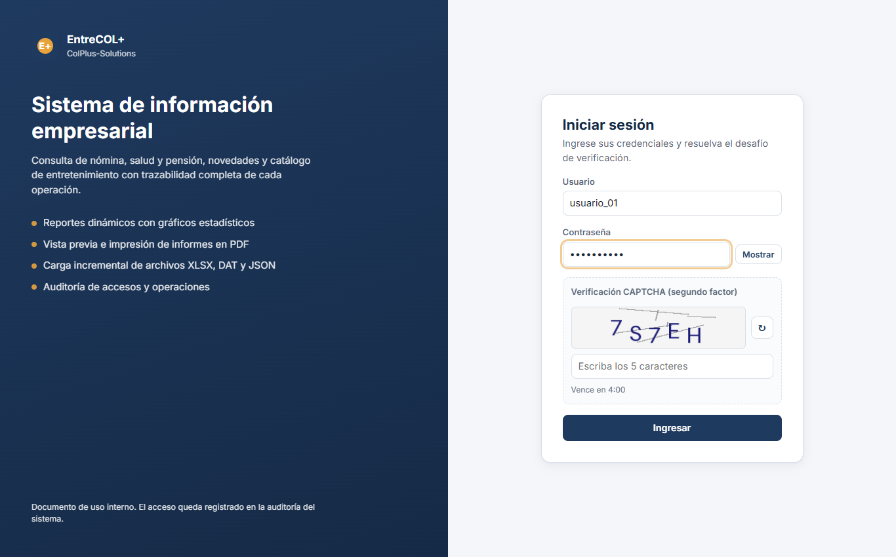

1. Escriba su **usuario** (por ejemplo `usuario_01`) y su **contraseña**. El botón **Mostrar** permite ver la contraseña escrita.
2. Lea los 5 caracteres de la imagen del recuadro **Verificación CAPTCHA** y escríbalos en el campo inferior. Las letras se convierten a mayúsculas automáticamente.
3. Si la imagen no se lee bien, pulse el botón **↻** para generar otro desafío.
4. El desafío vence a los 4 minutos (el contador "Vence en" lo indica). Cada desafío sirve para un solo intento.
5. Pulse **Ingresar**. Si los datos son correctos, el sistema valida el token de sesión (JWT) y abre el panel.

Si el CAPTCHA o las credenciales son incorrectos, aparece el mensaje en rojo, se borra la contraseña y se genera un nuevo desafío. Todos los intentos, exitosos o fallidos, quedan en la auditoría.

La sesión dura 8 horas. Al vencer, el sistema regresa al inicio de sesión con el aviso "Su sesión expiró".

## 3. Estructura del panel

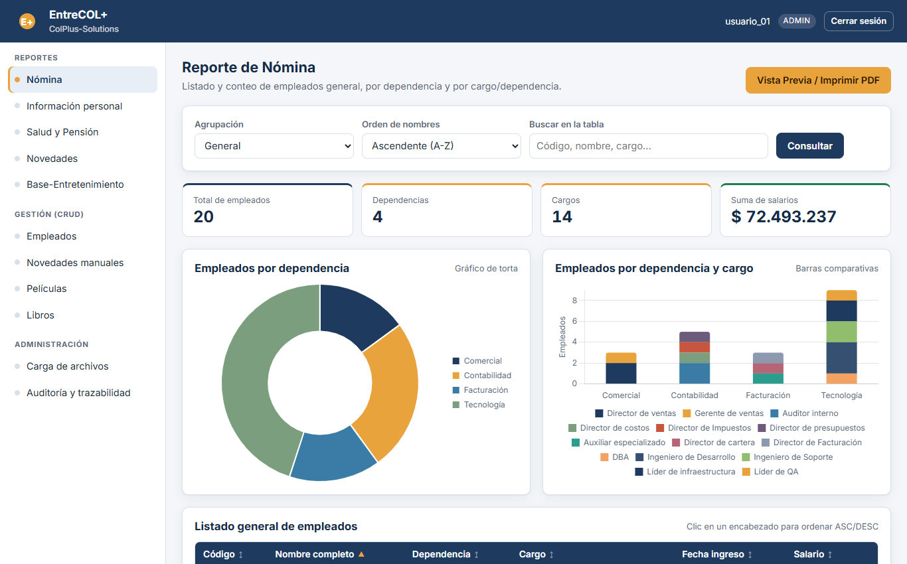

- **Barra superior:** nombre del usuario, su rol (`ADMIN`, `AUDITOR` o `USUARIO`) y el botón **Cerrar sesión** (pide confirmación).
- **Menú lateral**, organizado en tres grupos:
  - **Reportes:** Nómina, Información personal, Salud y Pensión, Novedades y Base-Entretenimiento.
  - **Gestión (CRUD):** Empleados, Novedades manuales, Películas y Libros.
  - **Administración:** Carga de archivos y Auditoría y trazabilidad.
- **Área de contenido:** muestra el módulo seleccionado. La dirección del navegador conserva el módulo (`dashboard.html#nomina`, `#auditoria`, etc.), de modo que al recargar la página se vuelve al mismo lugar.

## 4. Elementos comunes: filtros, ordenamiento y PDF

| Elemento | Uso |
|---|---|
| **Orden (ASC/DESC)** | Selector que pide al servidor los nombres o títulos en orden ascendente (A-Z) o descendente (Z-A). |
| **Encabezados de tabla** | Clic en cualquier encabezado para ordenar esa columna; un segundo clic invierte el orden. La flecha ▲/▼ indica el orden activo. |
| **Fechas F1 y F2** | En Novedades se escriben en formato `MM/AAAA` (por ejemplo `03/2022`). En Entretenimiento se eligen en el calendario y se envían como `YYYY-MM-DD`. F1 no puede ser posterior a F2. |
| **Parámetro N** | Campo numérico (entero mayor o igual a 1) para "películas con N géneros" y "Top N libros". |
| **Indicadores** | Tarjetas con totales y conteos del resultado. |
| **Paginación** | Las tablas largas muestran 100 filas por página con los botones **Anterior** y **Siguiente**. |
| **Vista Previa / Imprimir PDF** | Botón naranja en cada reporte que genera el PDF con los mismos filtros de la pantalla. |

## 5. Reporte de Nómina

1. Elija la **Agrupación**: *General*, *Por dependencia* o *Por cargo y dependencia*.
2. Elija el **Orden de nombres** (ASC o DESC). La consulta se actualiza al cambiar cualquiera de los dos.
3. Use **Buscar en la tabla** para filtrar por código, nombre, dependencia o cargo sin volver a consultar.

La pantalla muestra el total de empleados, el número de dependencias y cargos, la suma de salarios, un **gráfico de torta** con los empleados por dependencia y un **gráfico de barras comparativas** con los empleados por dependencia y cargo.

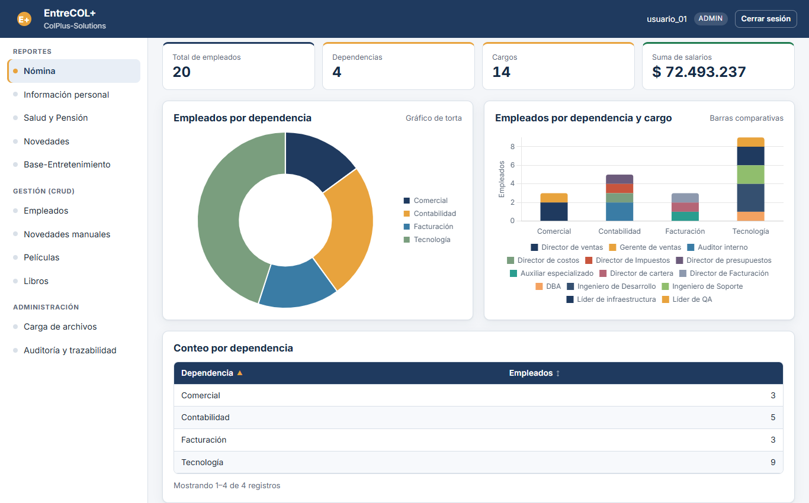

En las agrupaciones por dependencia o por cargo aparece además la tabla de **conteo**, y el listado se separa en bloques con el nombre del grupo y su cantidad de empleados.

## 6. Reporte de Información Personal

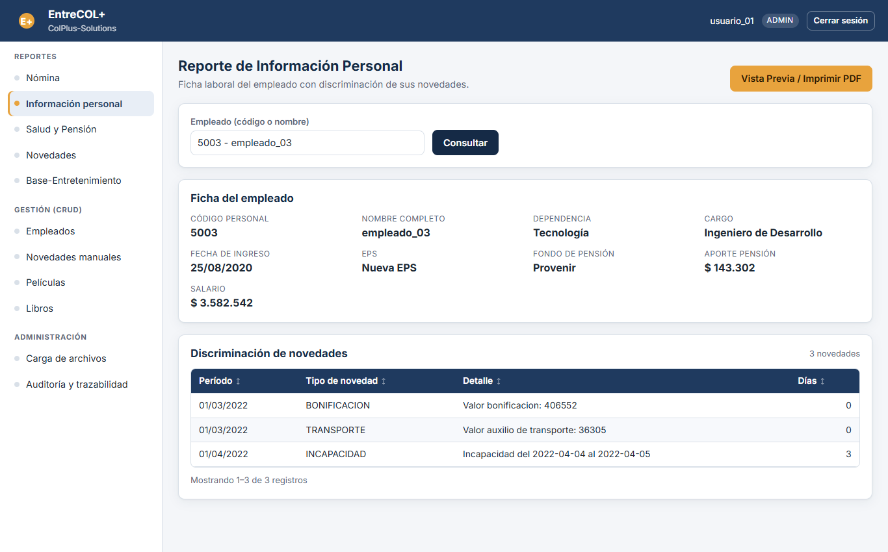

1. En **Empleado** escriba parte del código o del nombre; la lista sugiere coincidencias en el formato `código - nombre`.
2. Seleccione el empleado y pulse **Consultar**.
3. La ficha muestra **Código Personal, Nombre completo, Dependencia, Cargo, Fecha de ingreso (DD/MM/AAAA), EPS, Fondo de pensión, Aporte Pensión y Salario**.
4. La tabla **Discriminación de novedades** lista cada novedad del empleado (período, tipo, detalle y días).
5. El botón **Vista Previa / Imprimir PDF** genera la ficha del empleado consultado; si aún no se ha consultado ninguno, el sistema lo indica.

## 7. Reporte de Salud y Pensión

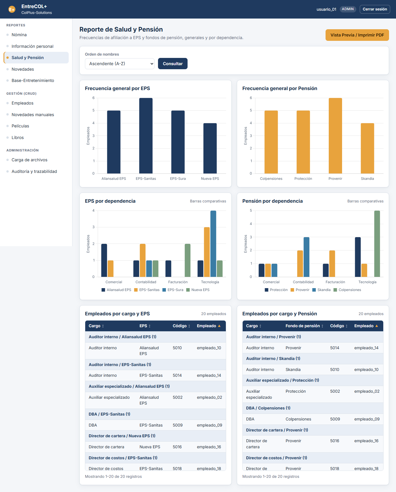

- **Frecuencia general por EPS** y **Frecuencia general por Pensión:** barras con la cantidad de empleados afiliados a cada entidad.
- **EPS por dependencia** y **Pensión por dependencia:** barras comparativas que muestran, en cada dependencia, cuántos empleados hay en cada entidad.
- **Empleados por cargo y EPS** y **por cargo y Pensión:** tablas agrupadas por cargo y entidad; el selector **Orden de nombres** cambia el orden de los empleados dentro de cada grupo.

## 8. Reporte de Novedades

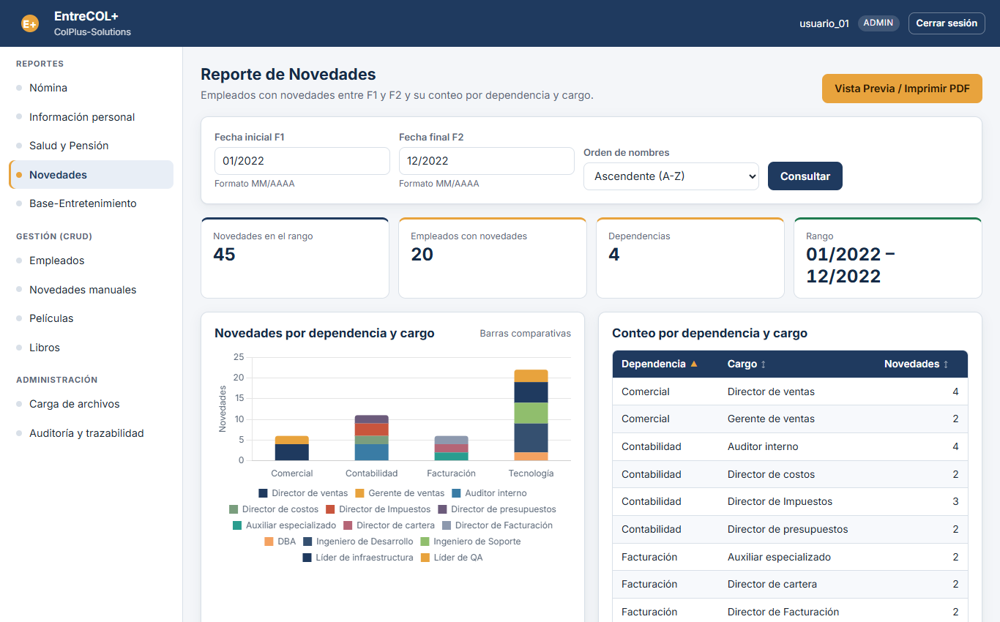

1. Escriba **F1** y **F2** en formato `MM/AAAA`. La barra se agrega sola mientras escribe los números (por ejemplo, al escribir `032022` queda `03/2022`).
2. Elija el orden de nombres y pulse **Consultar**.
3. El sistema muestra el número de novedades del rango, los empleados con novedades, el gráfico de barras por dependencia y cargo, la tabla de conteo y el listado detallado agrupado por dependencia y cargo.

Si el formato es incorrecto (por ejemplo `13/2022`) o F1 es posterior a F2, aparece un mensaje en rojo y no se envía la consulta.

## 9. Reporte de Base-Entretenimiento

El reporte tiene cuatro pestañas. El botón **Vista Previa / Imprimir PDF** genera el PDF de la pestaña activa.

### 9.1 Películas por género (F1–F2)

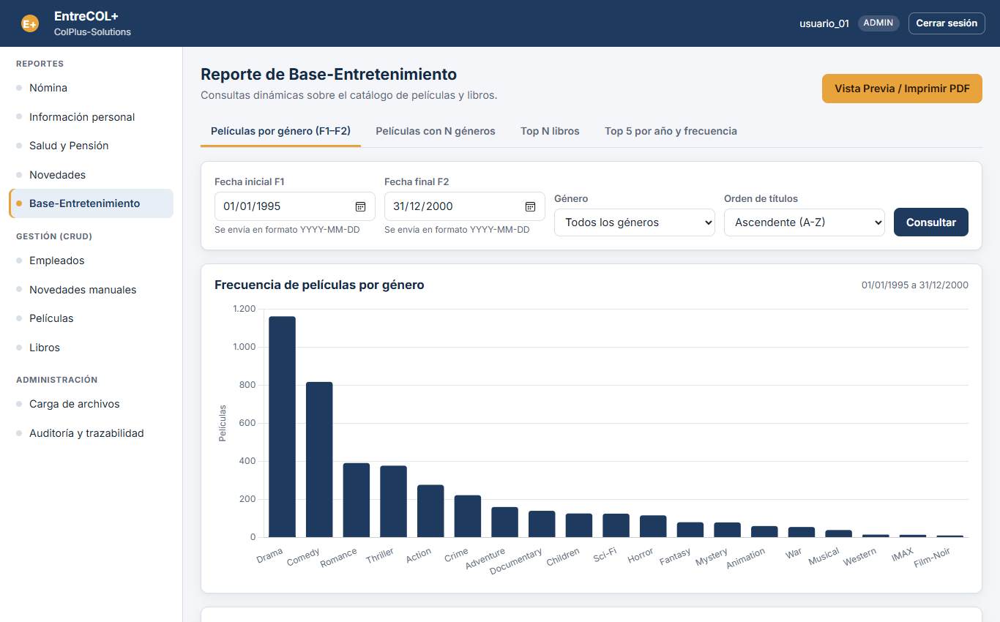

1. Elija **F1** y **F2** en el calendario, un **Género** (opcional) y el **Orden de títulos**.
2. Pulse **Consultar**. Se dibuja el gráfico de **frecuencia de películas por género** en el rango y, debajo, el listado de películas agrupado por género con el total de registros.

### 9.2 Películas con N géneros

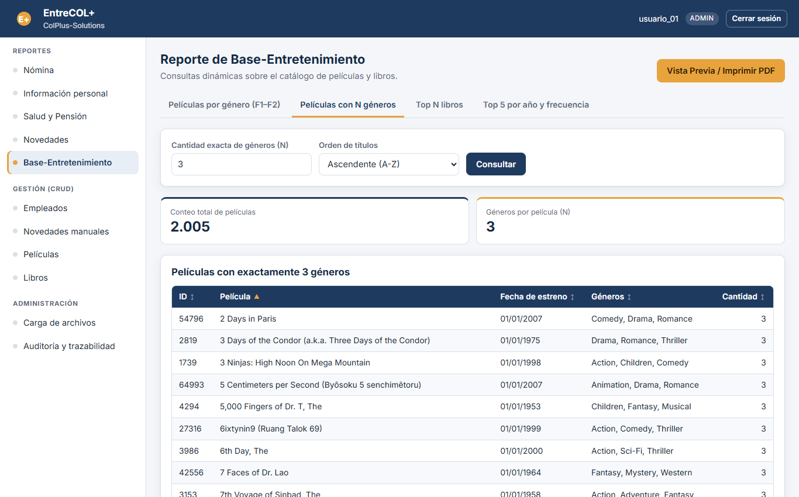

Escriba **N** y pulse **Consultar**. Se muestra el **conteo total** de películas que tienen exactamente N géneros y su listado con los géneros de cada una.

### 9.3 Top N libros

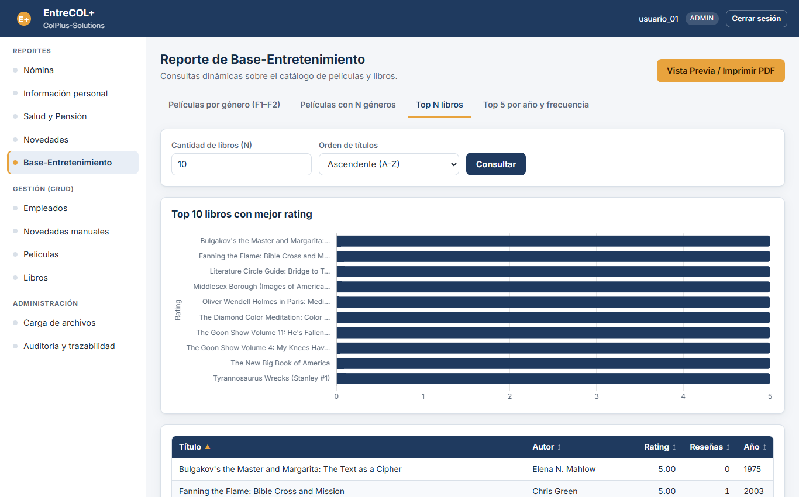

Escriba **N** (por ejemplo 10) y el orden de títulos. El sistema toma los N libros con mejor rating y los presenta en un gráfico de barras horizontales y en una tabla con autor, rating, reseñas y año.

### 9.4 Top 5 por año y frecuencia

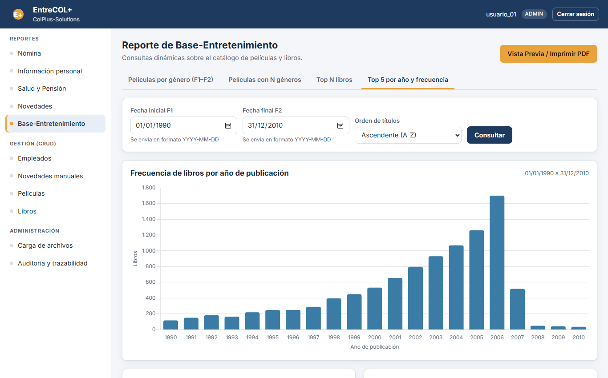

Elija **F1** y **F2**. Se muestra el gráfico de **frecuencia de libros por año de publicación** en ese rango y dos tablas agrupadas por año: **Top 5 con mejor rating** y **Top 5 con peor rating**.

## 10. Vista previa, descarga e impresión de PDF

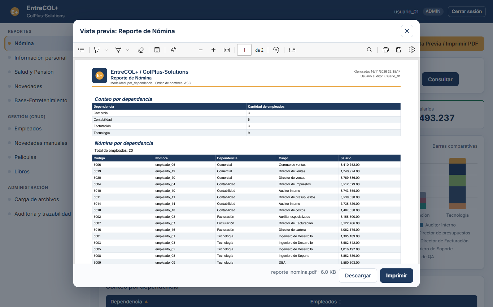

1. En cualquier reporte pulse **Vista Previa / Imprimir PDF**. Se abre una ventana con el informe generado por el servidor (encabezado corporativo, filtros aplicados, fecha y hora de generación, usuario y numeración "Página X de Y").
2. Pulse **Descargar** o **Imprimir**. El sistema pide confirmación antes de continuar:

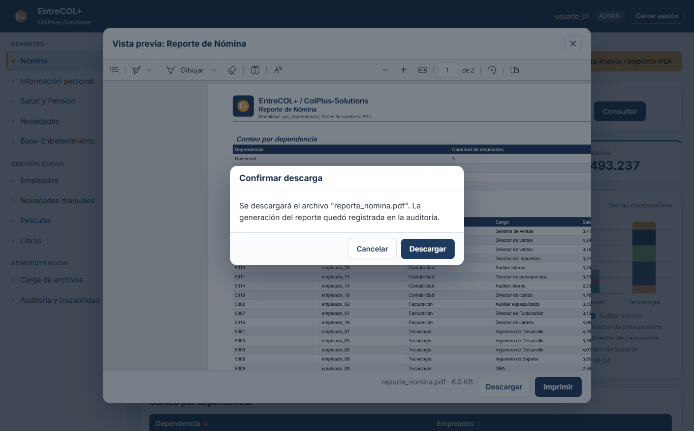

3. Al confirmar, el archivo se descarga (`reporte_<tipo>.pdf`) o se abre el cuadro de impresión del navegador.
4. Cada generación de PDF queda registrada en la auditoría con la acción `EXPORTAR_PDF`.

## 11. Gestión (CRUD)

Los cuatro módulos de gestión funcionan igual:

| Acción | Cómo se hace |
|---|---|
| **Listar** | Al entrar al módulo se muestra la tabla. Los filtros de la parte superior se aplican con **Filtrar/Buscar**; **Limpiar** los quita. |
| **Crear** | Botón **+ Nuevo** (arriba a la derecha), diligenciar el formulario y **Guardar**. Los campos obligatorios se marcan en rojo si quedan vacíos o con formato inválido. |
| **Editar** | Botón **Editar** de la fila; el formulario se abre con los datos actuales. |
| **Eliminar** | Botón **Eliminar** de la fila; el sistema pide confirmación. La eliminación no se puede deshacer y queda registrada en la auditoría. |

### 11.1 Empleados

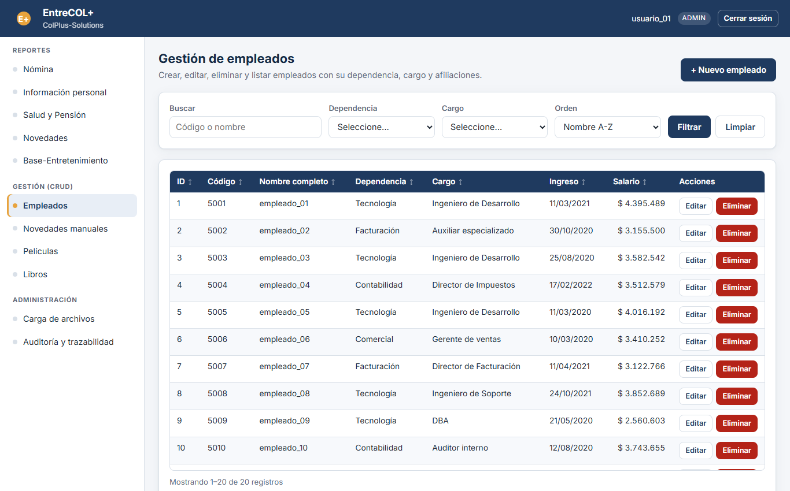

Filtros por texto (código o nombre), dependencia, cargo y orden. El formulario pide código personal, número de documento, nombre completo, dependencia, cargo, EPS, fondo de pensión, salario y fecha de ingreso.

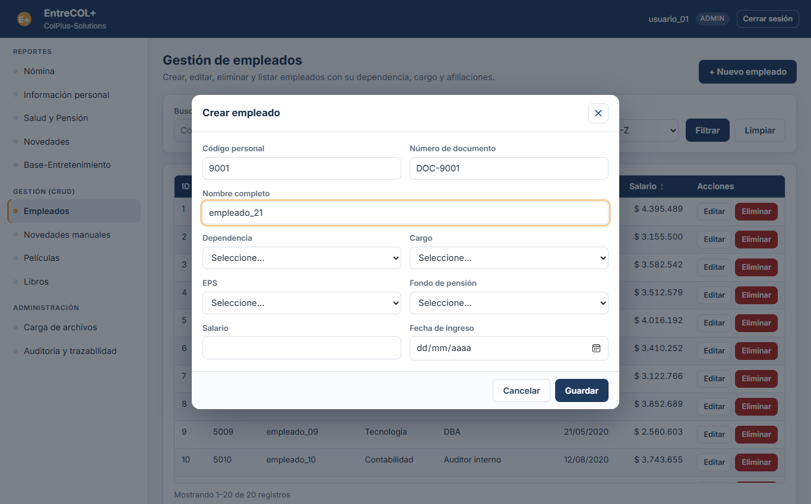

### 11.2 Novedades manuales

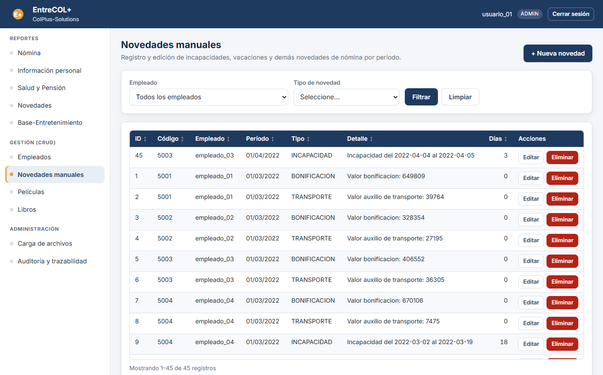

Permite registrar incapacidades, vacaciones, bonificaciones o auxilios de transporte de un empleado en un **período** (mes y año). Se diligencian el empleado, el tipo de novedad, el período, los días reportados y el detalle. Solo puede haber una novedad de cada tipo por empleado y período.

### 11.3 Películas

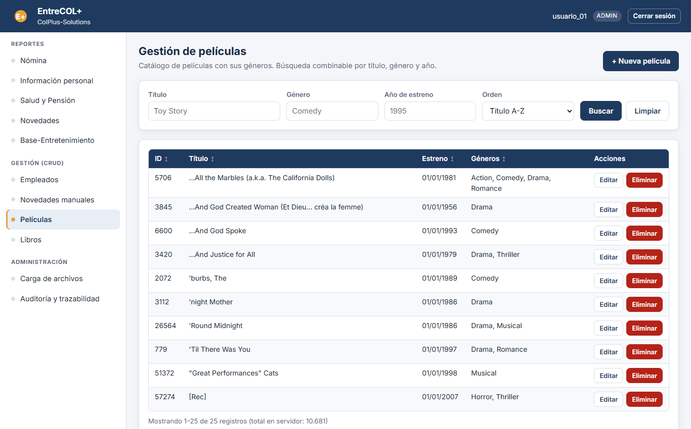

Búsqueda combinable por título, género y año de estreno, con paginación de 25 registros. En el formulario los géneros se escriben separados por comas (`Comedy, Drama`); si un género no existe se agrega al catálogo. El identificador de la película no se puede cambiar al editar.

### 11.4 Libros

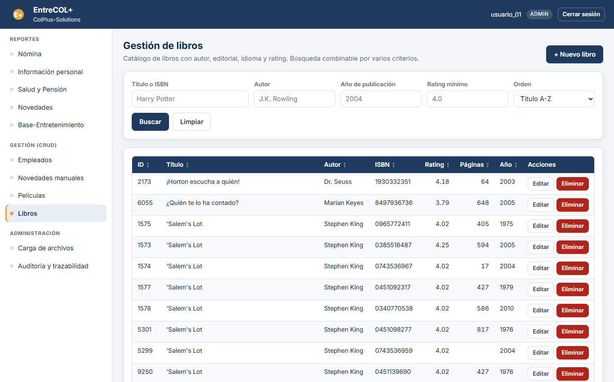

Búsqueda por título o ISBN, autor, año de publicación y rating mínimo. El ISBN debe tener 10 caracteres (el último puede ser `X`) o 13 dígitos, y el rating debe estar entre 0 y 5.

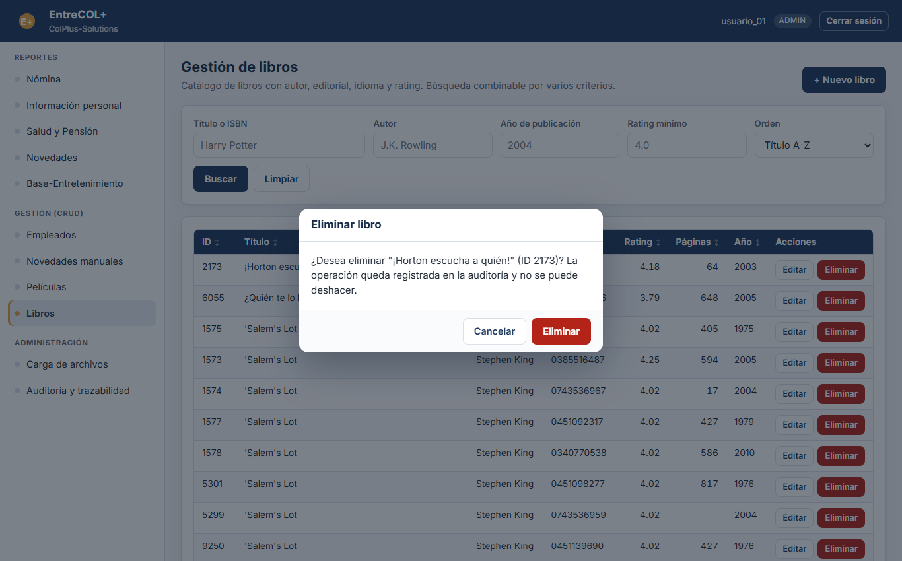

## 12. Carga incremental de archivos

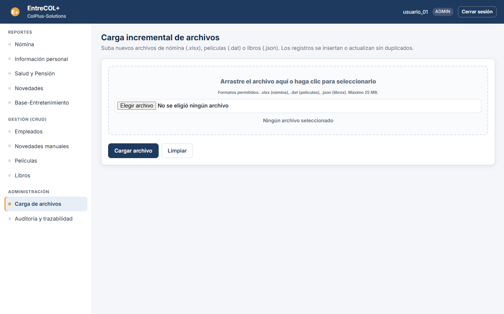

1. Arrastre el archivo al recuadro o haga clic para seleccionarlo. Formatos admitidos:
   - `.xlsx`: nómina (misma estructura de `Nomina.xlsx`). Aparece el campo **Período de la nómina** para indicar el mes de las hojas mensuales.
   - `.dat`: películas (`id::Título (año)::Género|Género`).
   - `.json`: libros (misma estructura de `Books.json`).
2. Pulse **Cargar archivo** y confirme.
3. El sistema inserta los registros nuevos y actualiza los existentes sin duplicarlos.

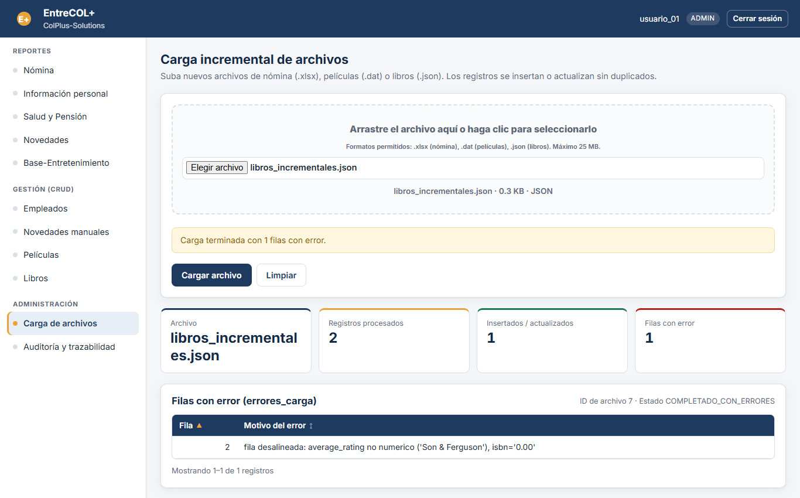

Al terminar se muestran los **registros procesados**, los **insertados / actualizados**, las **filas con error** y el **estado** de la carga (`COMPLETADO`, `COMPLETADO_CON_ERRORES` o `FALLIDO`). La tabla **Filas con error** indica el número de fila del archivo y el motivo exacto del rechazo (tabla `errores_carga`). Los archivos con otra extensión o de más de 25 MB se rechazan antes de enviarse.

## 13. Auditoría y trazabilidad

### 13.1 Registros de auditoría

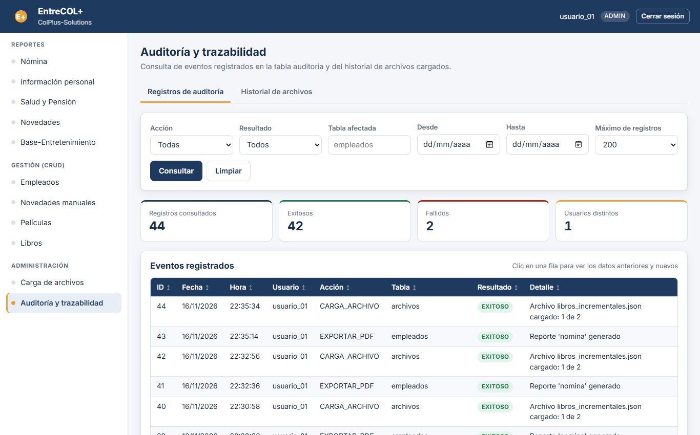

Filtre por **acción** (`LOGIN`, `REGISTRO`, `EXPORTAR_PDF`, `CARGA_ARCHIVO`, `INSERT`, `UPDATE`, `DELETE`), **resultado** (`EXITOSO`/`FALLIDO`), **tabla afectada**, rango de fechas y cantidad máxima de registros. Los indicadores resumen los eventos exitosos, fallidos y los usuarios distintos. Los intentos de acceso de usuarios inexistentes aparecen como **Anónimo**.

Al hacer clic en una fila se abre el detalle con los **datos anteriores** y los **datos nuevos** del registro afectado:

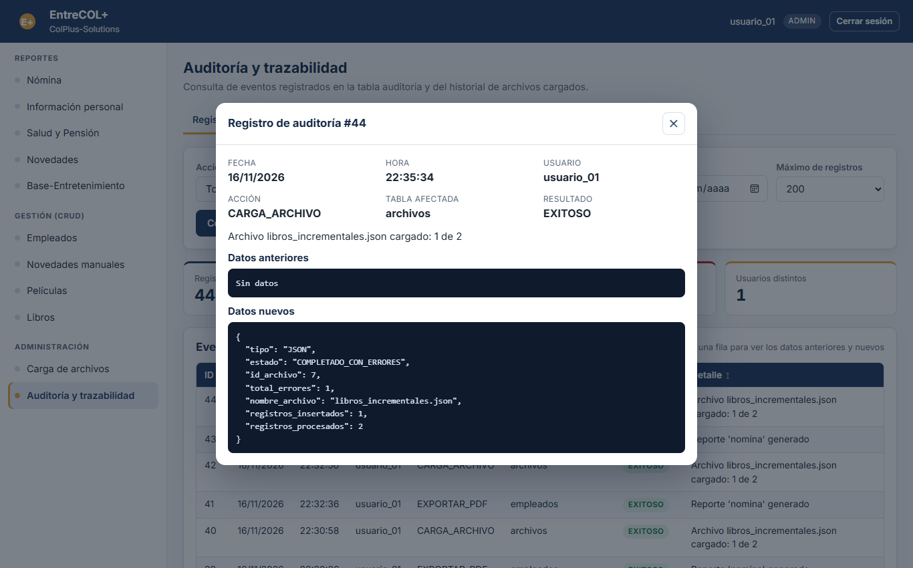

### 13.2 Historial de archivos

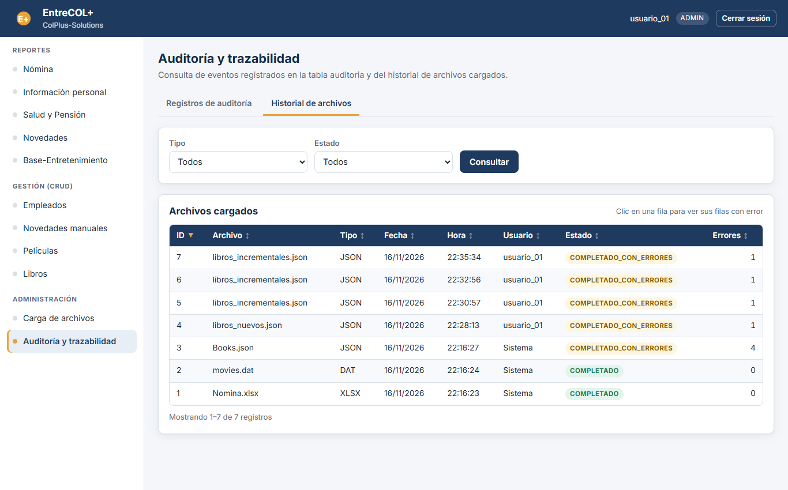

Lista cada archivo cargado con su tipo, fecha, hora, usuario, estado y número de errores. Al hacer clic en una fila se ven las filas rechazadas de ese archivo.

## 14. Uso en celular

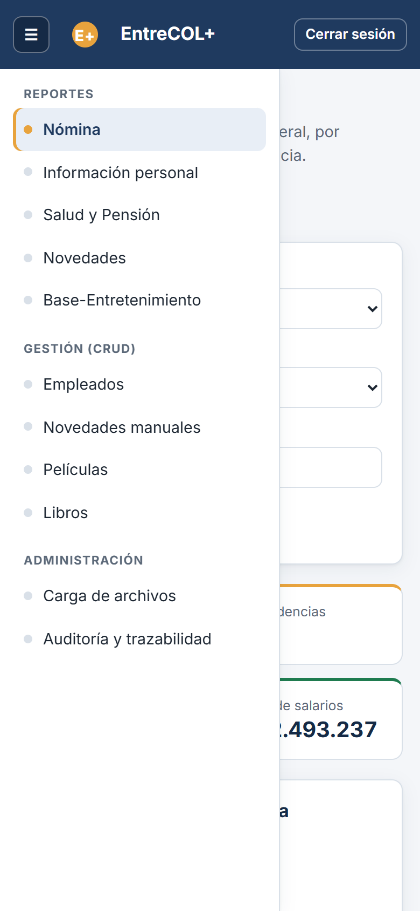

En pantallas pequeñas el menú lateral se oculta; se abre con el botón **☰** de la barra superior. Los filtros, gráficos y tablas se reorganizan en una sola columna y las tablas anchas se desplazan horizontalmente dentro de su recuadro.

## 15. Mensajes frecuentes y solución de problemas

| Mensaje | Causa | Solución |
|---|---|---|
| "No se pudo conectar con el backend en http://localhost:5000" | La API no está en ejecución o la dirección de `api-base` es otra. | Iniciar `python backend/app.py` o corregir la etiqueta `<meta name="api-base">`. |
| "CAPTCHA inválido o expirado" | Caracteres mal escritos o desafío vencido. | Escribir el nuevo desafío que se genera automáticamente. |
| "Credenciales inválidas" | Usuario o contraseña incorrectos. | Verificar los datos; el intento queda en la auditoría. |
| "Su sesión expiró" | Pasaron 8 horas desde el inicio de sesión o el token es inválido. | Iniciar sesión de nuevo. |
| "F1 y F2 deben tener el formato MM/AAAA" | Fecha mal escrita en Novedades. | Escribir mes de dos dígitos y año de cuatro, por ejemplo `03/2022`. |
| "No se encontró la vista views/... Abra el frontend con un servidor local" | Se abrió `dashboard.html` con doble clic (`file://`). | Abrir el proyecto con Live Server. |
| "La base de datos no está disponible" | MySQL detenido o credenciales de `.env` incorrectas. | Iniciar el servicio MySQL y revisar `backend/.env`. |
| "Formato no permitido" en la carga | El archivo no es `.xlsx`, `.dat` ni `.json`. | Convertir el archivo al formato correspondiente. |
